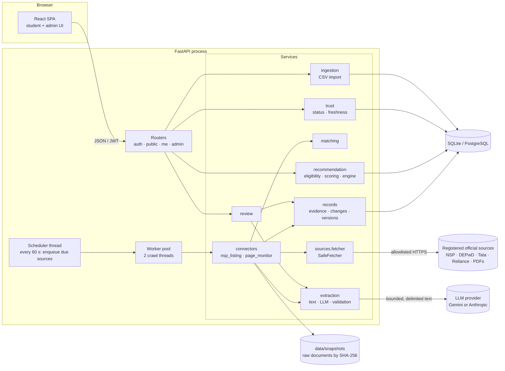

# Architecture

ScholarScope is a **modular monolith**: one FastAPI process (API + in-process scheduler + a small worker pool) and one
relational database, with a React single-page app. Microservices were deliberately not used; the module boundaries
below are where they would split if ever needed.

## Component diagram



## Data flow: source check to student recommendation

```mermaid
sequenceDiagram
  participant S as Scheduler / admin
  participant O as Orchestrator
  participant F as SafeFetcher
  participant C as Connector
  participant M as Matching
  participant R as Records
  participant T as Trust
  S->>O: enqueue(source) (one active job per source)
  O->>F: fetch(url, allowed patterns, ETag/Last-Modified)
  F-->>O: bytes or FetchError (403 → paused, 5xx → backoff)
  O->>C: parse (deterministic parser / page text)
  C->>M: resolve each scheme → existing record? possible? new?
  alt matched
    C->>R: observe_field(deadline, open_date, …) → evidence + change event
    R->>R: auto-accept only if policy allows; else pending
    R->>R: commit_version (old version kept)
  else uncertain or new
    C->>R: create/merge pending Candidate (never auto-published)
  end
  O->>T: refresh verification status of touched records
  Note over O: any exception → rollback; job failed; nothing partially applied
```

At request time the recommendation engine evaluates every published record against the student profile
(three-valued criteria), attaches the highest-precedence current evidence to each criterion, scores only
non-excluded records, and ranks by outcome tier → availability → relevance.

## Module responsibilities

| Module | Responsibility | Never does |
|---|---|---|
| `normalize` | Vocabulary-driven interpretation of free text (`config/vocabulary.json`) | Guess values that are not stated |
| `ingestion.csv_import` | Import / re-import with per-row report; re-imports produce change events | Silently overwrite existing records |
| `sources.fetcher` | Polite, bounded, allowlisted HTTP; fixtures for tests | Bypass robots.txt, logins, CAPTCHAs or 403s |
| `connectors.nsp_listing` | Parse NSP listing deterministically | Infer dates not printed on the page |
| `connectors.page_monitor` | Baseline, cosmetic filter, material diff, closure/deadline rules, optional AI extraction | Auto-apply rule-based or AI values |
| `matching` | Score name/URL/provider similarity with discriminator words | Merge when uncertain |
| `records` | Field evidence, change events, materiality, auto-accept policy, versions | Discard previous values |
| `trust` | Verification status and freshness from stored facts | Produce an unexplained numeric "trust score" |
| `extraction` | Bounded text → LLM → schema/range/quote/context validation | Present unverified values as extracted; fall back to mock data |
| `review` | Publish/link/reject candidates, accept/reject changes, audited | Publish without required fields |
| `recommendation` | Eligibility (three-valued), relevance score, explanations, snapshots | Treat unknown as satisfied; present score as probability |

## Key design decisions

1. **Deterministic first, AI second.** Deadlines and windows come from a deterministic parser of the official listing.
   AI extraction is only used for unstructured guideline text, and its output always goes to review.
2. **Evidence per field, not per record.** Each observation keeps value, source, snippet, location, method, time and
   verification status, so conflicting or superseded values remain inspectable.
3. **Policy-based auto-acceptance** (`config/policies.json`): only official-source, deterministic-parser changes to
   date/window fields are applied automatically; everything else waits for an admin.
4. **Failures are first-class.** A failed check rolls back fully, is recorded with its error type, updates source health
   and backoff, and is visible to students as "source unavailable" rather than hidden.
5. **SQLite for development, PostgreSQL-ready.** All types are portable (JSON, timezone-aware datetimes via a
   `UTCDateTime` type decorator); migrations use Alembic batch mode.
